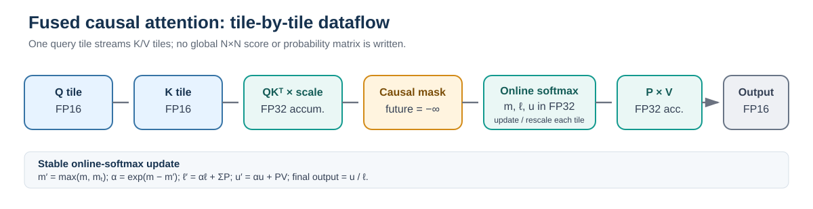
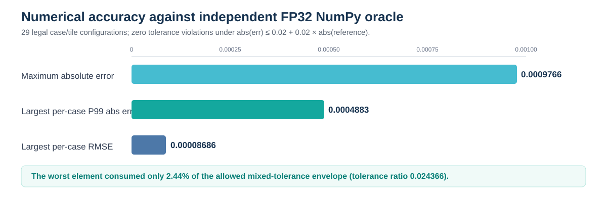
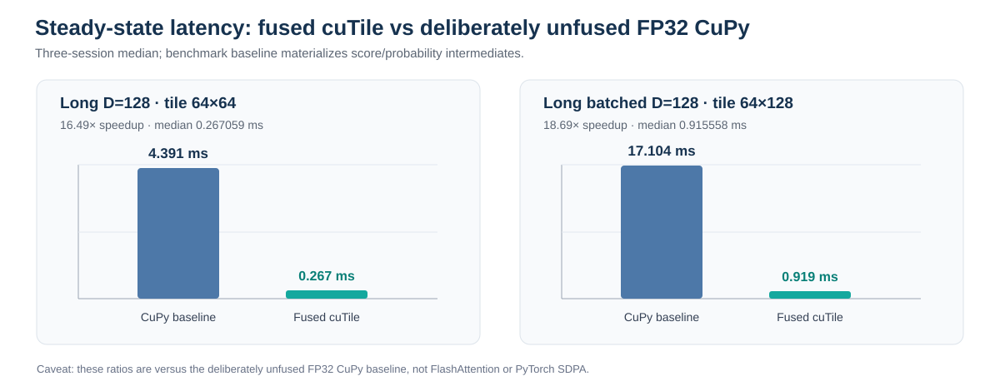
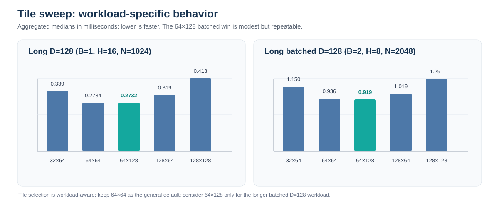
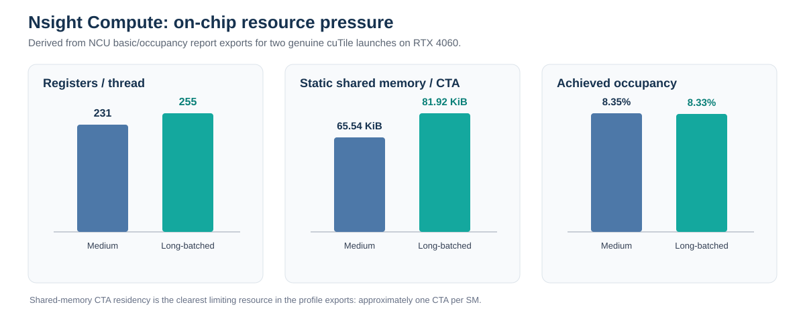
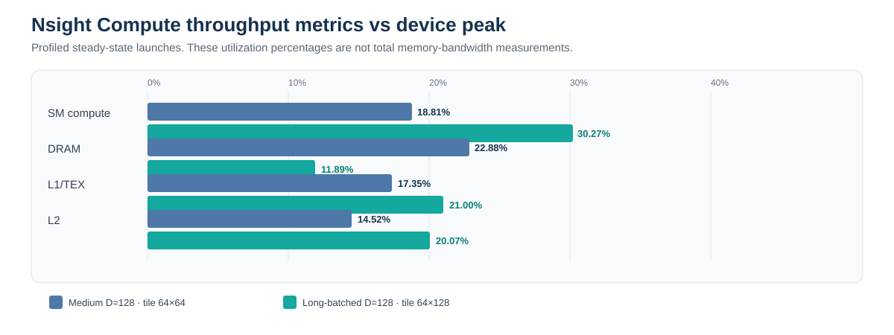
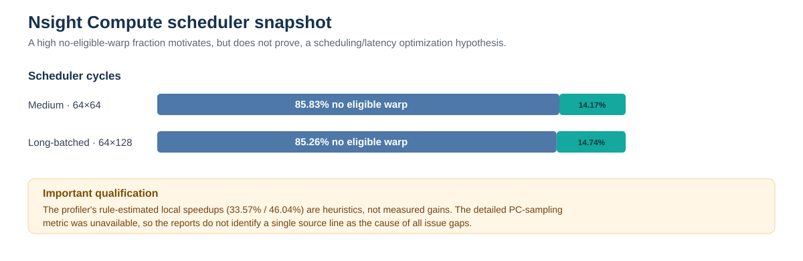

# Fused Causal Attention with NVIDIA cuTile — Complete Experiment Report

**Evidence snapshot:** 19 October 2026  
**Core implementation:** src/cutile_attention.py  
**Target:** NVIDIA GeForce RTX 4060, native Windows x64, compute capability 8.9  
**Report policy:** This is the technical narrative and experiment ledger. Automation-only provenance is kept in a separate file. The report includes only project, numerical, CUDA, dependency, and profiler errors; automation-service and runner failures are excluded.

> **Current source status (24 October 2026):** The last complete native GPU run is [#39422402438](https://github.com/xemptynothing/gpu-nvidia/actions/runs/39422402438) on commit bf5a623. It passed the 48 core GPU tests, three selected extension tests, 29 numerical configurations, CLI check, three timing sessions and two Nsight Compute configurations. The cuTile kernel was compacted after that run. Rerun the current source on the RTX 4060 before calling those results current.
>
> **Performance boundary:** Timing results are against the deliberately unfused FP32 CuPy baseline. The CUDA-enabled PyTorch SDPA comparison is not complete, so do not claim a speedup over FlashAttention or optimized PyTorch attention. Clean-cache JIT timing for long specializations and another measured profiler-guided improvement also remain open.

## 1. Executive summary

This project implements causal scaled dot-product self-attention as a genuine NVIDIA cuTile Python fused kernel. The kernel computes attention tile by tile, applies the triangular causal mask, maintains an online-softmax state in FP32, and avoids writing a complete sequence-by-sequence score or probability matrix to global memory.

The validated native RTX 4060 evidence establishes:

- Genuine cuTile runtime smoke: compiled/launched/synchronized and checked 4,096 outputs exactly.
- Required actual-cuTile attention tests: 48 passed, 0 failed, with REQUIRE_CUTILE=1 so missing GPU dependencies cannot silently skip the required gate.
- Independent numerical report: 29 legal case/tile configurations, zero tolerance violations.
- CLI path: deterministic FP16 output matched an independent FP32 NumPy oracle.
- Controlled performance: three independent sessions over the seven workload families and up to five legal tile shapes, 10 warmups, 30 CUDA-event samples per configuration, and five launches averaged per sample.
- Nsight Compute: four actual-cuTile reports—two resource/throughput reports and two scheduler/warp-state reports—were exported and inspected. Hardware-counter collection worked on the RTX 4060.

The latest three-session benchmark [#39422402438](https://github.com/xemptynothing/gpu-nvidia/actions/runs/39422402438) measured the long D=128 case at **0.267059 ms median with tile 64×64 (16.49×)** and the longer-batched D=128 case at **0.915558 ms with tile 64×128 (18.69×)** versus the intentionally unfused FP32 CuPy baseline. Across-session ranges were 0.9% and 0.5%, respectively. Medium D=128 / 64×64 was 0.058368 ms with 9.8% session range. The benchmark used ten warmups, 30 CUDA-event samples, five launches averaged per sample and three order-rotated sessions. Keep 64×64 as the general default; 64×128 is workload-specific. These are not speedups versus FlashAttention or vendor-optimized PyTorch SDPA.

These speedups are not comparisons against FlashAttention or vendor-optimized PyTorch SDPA. Optional APIs and tests have since been added for GQA/MQA and packed sequences, plus an autotuning script, a PyTorch autograd/model bridge, and a documented DRAM-load-latency hint sweep. They are implementation-in-progress, not validated features, until the latest GPU gates run. The framework attention comparison and model timing are pending actual installation and execution.

## 2. Assignment contract

The original assignment is [nvidia2-cutile.pdf](nvidia2-cutile.pdf) in the repository root. The main required contract is:

- Q, K and V are contiguous FP16 tensors with logical layout [B,H,N,D].
- Required dimensions are D ∈ {32, 64, 128}; causal self-attention forward pass only.
- QK, scaling/masking/softmax, and weighted V calculation are fused into one cuTile kernel launch per output tensor.
- QK accumulation, online-softmax state and denominator, and P×V accumulation remain FP32; output is FP16.
- Future keys are masked so query i can attend only to key positions j ≤ i.
- The full N×N score/probability matrix is not written to global memory.
- Current core scope requires sequence dimensions divisible by the chosen tiles; partial edge tiles, dropout, backward, BF16/FP8, grouped-query/multi-query attention, KV cache and packed variable lengths are not part of the core acceptance contract.
- CLI input is NPZ and output is NPY through run_attention.py.
- Correctness is compared with independent numerical references. Performance needs an unfused baseline, multiple tiles, warmups and repeated GPU-event measurements with cold/JIT observations kept separate.
- Two successful, inspectable actual-cuTile profiler captures are required. The current two workload configurations each have a basic and scheduler/warp-state report.

The assignment also identifies a framework/vendor attention reference as a useful performance comparison, but states that it is not part of the speedup grade. It describes a second profiler-guided improvement as a Week 3 milestone and lists additional optional extensions. Those are tracked independently below; a core pass does not imply those extensions are done.

## 3. Environment and dependency inventory

| Component | Validated core environment |
|---|---|
| GPU | NVIDIA GeForce RTX 4060 |
| Compute capability | 8.9 / SM89 |
| OS | Native Windows x64, build 26300, WDDM |
| NVIDIA driver | 616.92 |
| Reported GPU memory | 8,188 MiB |
| Python | CPython 3.12.10 |
| NumPy | 2.5.4 |
| CuPy | 14.2.0 |
| NVIDIA cuTile Python | cuda-tile 1.6.0 |
| TileIRAS / NVCC / NVVM Python components | 13.4.92 |
| CUDA toolkit Python distribution | 13.4.3 |
| Nsight Compute CLI | 2026.3.1.0, build 38829034 |
| System-wide CUDA Toolkit / nvcc | Not installed; the validated project-venv packaging route supplies compiler/runtime components |

The environment is in .venv-cutile-windows. NVIDIA's [cuTile Python Quickstart](https://docs.nvidia.com/cuda/cutile-python/quickstart.html) documents Windows x86-64 support, compute capability 8.x–12.x, a current R580+ driver prerequisite, and an install route that supplies TileIR compiler components into the virtual environment. CUDA minor-version compatibility is described in NVIDIA's [CUDA Toolkit release notes](https://docs.nvidia.com/cuda/cuda-toolkit-release-notes/index.html) and [CUDA Compatibility Guide](https://docs.nvidia.com/deploy/cuda-compatibility/index.html). The validated 616.92 driver meets the cuTile requirement.

The project-local Windows venv contains PyTorch 2.14.0+cu130. CUDA availability and SDPA forward execution work, but the current `torch.bmm` sanity test fails with `CUBLAS_STATUS_INVALID_VALUE` before the cuTile bridge runs; subsequent model/gradient failures must therefore not be attributed to the cuTile kernel. A new isolated `.venv-torch-cu132-probe` tests the official PyTorch 2.14.0 CUDA 13.2 wheel without overwriting the existing venv. The probe's first run is tracked in [workflow #39423804493](https://github.com/xemptynothing/gpu-nvidia/actions/runs/39423804493); do not record framework timing until its basic GEMM smoke and subsequent integration tests pass. The cuTile kernel has compile-time KV_GROUPS=1 and LOAD_LATENCY=0 defaults; the current run preserves that global default while testing a specific alternative hint.

## 4. Algorithm and tile work decomposition

Causal scaled dot-product self-attention is

\[
S_{ij} =
\begin{cases}
(q_i \cdot k_j)/\sqrt{D}, & j \le i,\\
-\infty, & j > i,
\end{cases}
\qquad
P_{ij}=\frac{e^{S_{ij}}}{\sum_{r\le i}e^{S_{ir}}},
\qquad
o_i=\sum_{j\le i}P_{ij}v_j.
\]

The kernel assigns one program instance to a query tile for a batch/head and query-block index. It loads Q[TQ,D], streams K[TK,D] and V[TK,Dv] tiles, forms a temporary [TQ,TK] score tile, applies causal masking, updates the online-softmax state, accumulates P×V, and stores O[TQ,Dv]. The temporary score/probability values remain tile-sized; the full N×N matrix is never written to global memory.

### 4.1 Stable online-softmax derivation

For each query row, maintain the running maximum m, normalization sum ℓ, and unnormalized weighted-value accumulator u. Initialize m = −∞, ℓ = 0, u = 0. Given the current masked score tile Sₜ, calculate its maximum mₜ and then

\[
m'=\max(m,m_t),\qquad \alpha=e^{m-m'},\qquad P_t=e^{S_t-m'}.
\]

Causally masked entries in Pₜ are zero. The previous state is rescaled to the new maximum and combined with the current tile:

\[
\ell'=\alpha\ell+\sum_jP_{t,j},\qquad
u'=\alpha u+P_tV_t.
\]

Replace (m,ℓ,u) with (m′,ℓ′,u′), and after the final legal K/V tile return

\[
o=u/\ell.
\]

Rescaling both numerator and denominator to the new maximum preserves the result of the equivalent max-shifted softmax over every causal score while keeping the working set tile-sized. The running maximum stabilizes exponentiation. The kernel keeps this online state in FP32; P is converted to FP16 operands for P×V while the matrix multiply accumulator remains FP32. This mixed-precision choice was retained only after the independent numerical gates passed.

### 4.2 Two validated kernel optimizations

1. **Causal loop pruning:** skip all K/V tiles whose keys lie wholly beyond the last causal key for the current query tile, instead of loading/multiplying values that are going to be masked.
2. **Mixed-precision P×V operands:** cast probability operands to FP16 for the second matrix multiply, with FP32 score accumulation, online state, denominator and output accumulator.

The implementation uses the cuTile API documented in NVIDIA's [cuTile Python documentation](https://docs.nvidia.com/cuda/cutile-python/). The precision/type choices relevant to optional dtype extensions must be checked against the installed version's [data/type documentation](https://docs.nvidia.com/cuda/cutile-python/data.html) and verified experimentally, not inferred from an API name alone.

## 5. Correctness and numerical accuracy

Correctness is a hard acceptance gate. The actual-cuTile suite sets REQUIRE_CUTILE=1 so a missing CuPy/cuTile import fails rather than silently skipping the GPU matrix.

### 5.1 Independent references

- **FP32 NumPy full-matrix reference:** converts inputs to FP32, computes QKᵀ, scale, causal mask, max-shift softmax and PV; it is independent of the fused GPU algorithm.
- **Scalar FP64 reference:** explicit loops for small tensors, independently checking the mathematical definition.
- **Tiled online-softmax reference:** validates the running-max/running-normalization/output recurrence across small lengths and legal tile factorisations.
- **Unfused FP32 CuPy baseline:** materializes score/probability intermediates and is used as the project's intentionally unfused performance reference, not as an optimized vendor attention baseline.

The governing mixed tolerance is

\[
|O_{\mathrm{actual}}-O_{\mathrm{reference}}|
\le 0.02+0.02|O_{\mathrm{reference}}|.
\]

### 5.2 Measured validation results

| Validation item | Result |
|---|---|
| Genuine cuTile smoke | PASS; 4,096 outputs exactly checked |
| Required actual-cuTile attention suite | 48 passed, 0 failed |
| Independent legal numerical case/tile configurations | 29/29 passed, zero tolerance violations |
| CLI output | FP16, correct shape, finite |
| CLI versus independent NumPy oracle | PASS |
| Controlled benchmark sessions | Three independently run sessions completed |
| Actual-cuTile profiler capture | Two workload configurations, with basic and scheduler/warp-state reports for each |

| Numerical diagnostic | Worst observed value |
|---|---:|
| Maximum absolute output error | 0.0009765625 |
| Largest per-configuration P99 absolute error | 0.00048828125 |
| Largest per-configuration RMSE | 0.000086860741 |
| Maximum relative error where abs(reference) ≥ 0.01 | 0.02245863 (2.25%) |
| Maximum error / allowed tolerance | 0.024366 |
| Tolerance violations | 0 |

The maximum error consumed about 2.44% of the allowed mixed-tolerance envelope. This number is a tolerance-budget ratio; it does not mean the output has 2.44% error. Relative error becomes misleading when the reference is near zero, so the mixed absolute/relative check is the governing acceptance test.

### 5.3 Edge cases and validation contracts

The frozen GPU tests cover D=32/64/128, representative sequence lengths and batch/head sizes, legal tile configs, small and large score magnitudes, finite-output checks, shape/dtype/layout constraints, tile divisibility, causal future-key/value invariance, query locality, constant V, zero-logit prefix means and batch/head isolation. CLI generation uses deterministic seeds; the saved output is checked for shape, FP16 dtype, finiteness and independent-reference agreement.

The CPU/reference suite also tests scalar FP64 and tiled online-softmax references across many small shapes and factorizations. Its GPU-specific tests can be skipped when run in an environment without CuPy/CUDA. Those skips are not treated as evidence of GPU correctness; the native RTX 4060 run provides that evidence separately.

## 6. Performance methodology

The frozen benchmark uses seven workloads across D=32/64/128, multiple head counts and batch sizes. Five tile candidates are included where legal: 32×64, 64×64, 64×128, 128×64 and 128×128. There are 29 legal case/tile pairs.

- Ten warmup invocations per backend/configuration.
- Thirty CUDA-event samples per configuration/session.
- Each sample averages five launches, so 150 timed launches per case/tile/session.
- Three independent sessions with rotated/reversed tile order.
- The unfused FP32 CuPy baseline is measured before and after the tile sweep; the report uses the average of the bracketed baseline medians and records drift.
- Median, P90, speedup, output-byte throughput, session range and first-call/JIT-associated time are preserved in machine-readable JSON/CSV.
- First-call time is reported separately from steady-state CUDA-event measurements. It may include compiler/runtime cache effects and is not a pure compile-only measurement.
- Output throughput counts only bytes in the output tensor. It must not be called total memory bandwidth.

## 7. Full 29-case/tile benchmark table

All latency values are milliseconds; output throughput is GiB/s of output tensor bytes only. Range is the min–max spread of the three fused session medians divided by the aggregated median. Speedup is aggregated from the per-session speedup measurements (so it may differ slightly from dividing the displayed aggregate baseline median by aggregate fused median). Maximum baseline drift is the largest observed difference between the before/after unfused-baseline measurements. The complete machine-readable-backed 20 October snapshot is [here](docs/CUTILE_RTX4060_RESULTS_2026-10-20.md).

| Case | Tile | Fused median | Fused P90 | Unfused baseline | Speedup | Output GiB/s | Range | Max baseline drift |
|---|---:|---:|---:|---:|---:|---:|---:|---:|
| Long D=128 | 32×64 | 0.334950 | 0.337736 | 4.390656 | 13.11× | 11.66 | 0.06% | 0.03% |  |
| Long D=128 | 64×64 | 0.267059 | 0.269128 | 4.390656 | 16.49× | 14.63 | 0.92% | 0.03% |  |
| Long D=128 | 64×128 | 0.270848 | 0.273449 | 4.390656 | 16.19× | 14.42 | 1.13% | 0.03% |  |
| Long D=128 | 128×64 | 0.316109 | 0.319324 | 4.390656 | 13.89× | 12.36 | 0.78% | 0.03% |  |
| Long D=128 | 128×128 | 0.411853 | 0.415846 | 4.390656 | 10.66× | 9.48 | 0.79% | 0.03% |  |
| Long batched D=128 | 32×64 | 1.142989 | 1.146900 | 17.104077 | 14.97× | 6.84 | 0.31% | 0.08% |  |
| Long batched D=128 | 64×64 | 0.932966 | 0.936468 | 17.104077 | 18.33× | 8.37 | 0.33% | 0.08% |  |
| Long batched D=128 | 64×128 | 0.915558 | 0.921457 | 17.104077 | 18.69× | 8.53 | 0.50% | 0.08% |  |
| Long batched D=128 | 128×64 | 1.017139 | 1.020314 | 17.104077 | 16.83× | 7.68 | 0.23% | 0.08% |  |
| Long batched D=128 | 128×128 | 1.285120 | 1.289237 | 17.104077 | 13.32× | 6.08 | 0.32% | 0.08% |  |
| Medium D=128 | 32×64 | 0.069632 | 0.070659 | 0.390861 | 5.62× | 14.02 | 5.00% | 10.83% |  |
| Medium D=128 | 64×64 | 0.058368 | 0.058814 | 0.390861 | 6.70× | 16.73 | 9.82% | 10.83% |  |
| Medium D=128 | 64×128 | 0.058368 | 0.059044 | 0.390861 | 6.70× | 16.73 | 2.46% | 10.83% |  |
| Medium D=128 | 128×64 | 0.079053 | 0.079258 | 0.390861 | 4.94× | 12.35 | 5.31% | 10.83% |  |
| Medium D=128 | 128×128 | 0.107315 | 0.107950 | 0.390861 | 3.64× | 9.10 | 3.05% | 10.83% |  |
| Medium D=64 | 32×64 | 0.020070 | 0.021238 | 0.269562 | 14.00× | 12.16 | 95.92% | 1.32% |  |
| Medium D=64 | 64×64 | 0.017171 | 0.017833 | 0.269562 | 16.25× | 14.22 | 109.73% | 1.32% |  |
| Medium D=64 | 64×128 | 0.019456 | 0.020480 | 0.269562 | 14.40× | 12.55 | 90.05% | 1.32% |  |
| Medium D=64 | 128×64 | 0.019430 | 0.022733 | 0.269562 | 14.22× | 12.57 | 120.16% | 1.32% |  |
| Medium D=64 | 128×128 | 0.024944 | 0.026010 | 0.269562 | 11.15× | 9.79 | 76.36% | 1.32% |  |
| Short D=32 | 32×64 | 0.015770 | 0.018473 | 0.297270 | 19.10× | 0.24 | 2.09% | 77.46% |  |
| Short D=32 | 64×64 | 0.015974 | 0.018125 | 0.297270 | 18.73× | 0.24 | 0.64% | 77.46% |  |
| Short D=64 | 32×64 | 0.016074 | 0.018186 | 0.296243 | 18.25× | 0.47 | 5.20% | 1.69% |  |
| Short D=64 | 64×64 | 0.016282 | 0.018862 | 0.296243 | 18.33× | 0.47 | 1.36% | 1.69% |  |
| Short multi-head D=64 | 32×64 | 0.016074 | 0.018810 | 0.280320 | 16.96× | 3.80 | 3.70% | 4.93% |  |
| Short multi-head D=64 | 64×64 | 0.016179 | 0.018452 | 0.280320 | 17.15× | 3.77 | 1.29% | 4.93% |  |
| Short multi-head D=64 | 64×128 | 0.016566 | 0.019313 | 0.280320 | 16.96× | 3.68 | 3.71% | 4.93% |  |
| Short multi-head D=64 | 128×64 | 0.016794 | 0.018043 | 0.280320 | 16.69× | 3.63 | 3.66% | 4.93% |  |
| Short multi-head D=64 | 128×128 | 0.018842 | 0.020910 | 0.280320 | 14.88× | 3.24 | 4.35% | 4.93% |  |

### 7.1 Interpretation

- **Long D=128:** the latest three-session medians are 0.267059 ms for 64×64 and 0.270848 ms for 64×128; 64×64 is about 1.42% faster in this run. Retain 64×64 as the general default.
- **Long batched D=128:** 64×128 measures 0.915558 ms vs 0.932966 ms for 64×64 (about 1.86% faster), with a 0.50% session range and 0.08% maximum baseline drift. It remains the best-supported workload-specific specialization.
- **Medium D=128:** 64×64 and 64×128 tie at 0.058368 ms. Ranges differ materially (9.82% vs 2.46%), but maximum bracketed-baseline drift is 10.83%, so the raw tile result is not decisive. A separate hint sweep found LOAD_LATENCY=10 at 0.053248 ms (8.73% faster than the default), pending matched NCU review.
- **128×128:** loses on both long D=128 cases and produces high resource usage.
- **Short cases:** very noisy. Fused ranges reach 197%, and baseline drift reaches 81.17%; Windows launch/scheduling overhead dominates. Do not use these ratios as headline performance claims.

## 8. First-call/JIT observations

The harness records first-call wall time only once per specialization when first encountered. These are JIT-associated timings and may include cache hits; they are not pure compile-only latency. Null fields mean that the specialization had already been compiled in that process/session.

| Case / tile | First-call timings across sessions (ms) | Interpretation |
|---|---|---|
| Short D=32 / 32×64 | 1555.0, 27.2, 27.2 | Large first-call outlier in session 1; cache/compile state is not controlled |
| Short D=32 / 64×64 | 27.8, 1562.3, 1567.4 | Large first-call outliers in sessions 2 and 3; not stable cold-JIT evidence |
| Short D=64 / 32×64 | 26.9, 26.7, 27.8 | Typical first-call window |
| Short D=64 / 64×64 | 26.9, 27.2, 27.1 | Typical first-call window |
| Short multi-head D=64 / 64×128 | 27.2, 27.8, 27.2 | Typical first-call window |
| Short multi-head D=64 / 128×64 | 26.7, 28.5, 27.9 | Typical first-call window |
| Short multi-head D=64 / 128×128 | 26.9, 29.6, 26.8 | Typical first-call window |
| Medium D=128 / 32×64 | 29.4, 27.3, 27.1 | Typical first-call window |
| Medium D=128 / 64×64 | 26.2, 27.1, 28.2 | Typical first-call window |
| Medium D=128 / 64×128 | 86.2, 80.3, 28.0 | Two sessions show elevated first-call latency; likely cache/compile-state interaction |
| Medium D=128 / 128×64 | 27.6, 28.5, 81.9 | One session shows elevated first-call latency |
| Medium D=128 / 128×128 | 29.4, 32.9, 30.0 | Typical tens-of-milliseconds first-call window |
| Medium D=64, short multi-head 32×64/64×64, and all long specializations | Null in recorded sessions | Specializations already seen in those processes; deliberate clean-cache times remain unmeasured |

A controlled clean-cache measurement for the two long cases remains open. It must report first-call wall time separately from steady-state CUDA-event latency, clearly state cache conditions, and avoid substituting JIT-associated timings for kernel medians.

## 9. Nsight Compute analysis

The latest successful native profile run [#39414502490](https://github.com/xemptynothing/gpu-nvidia/actions/runs/39414502490) preserves eight actual-cuTile `.ncu-repz` reports with Details/Raw CSV exports and seven genuine Nsight Compute GUI screenshots. It covers the medium D=128 / 64×64 and longer-batched D=128 / 64×128 workloads, base and SchedulerStats/WarpStateStats profiles, and LOAD_LATENCY=4/8 captures for both shapes. One GUI capture (longer-batched LOAD_LATENCY=4) was skipped because `GetWindowRect` failed; the other seven PNGs were downloaded and visually checked. Artifact and complete manifest are linked in [docs/EXECUTION_EVIDENCE_INDEX.md](docs/EXECUTION_EVIDENCE_INDEX.md).

For interactive inspection, use NVIDIA's [Nsight Compute User Guide](https://docs.nvidia.com/nsight-compute/NsightCompute/index.html), [CLI guide](https://docs.nvidia.com/nsight-compute/NsightComputeCli/index.html), and [profiling guide](https://docs.nvidia.com/nsight-compute/ProfilingGuide/index.html). Native compressed reports use .ncu-repz; they can be opened/imported by Nsight Compute. The figures below are derived charts from the exported counters, not fabricated application screenshots.

### 9.1 Workload and kernel metadata

| Profile | Tensor shape | Tile Q×K | Grid CTAs / threads per block | NCU kernel duration |
|---|---|---:|---:|---:|
| Medium D=128 | B=1, H=8, N=512, D=128 | 64×64 | 64 / 128 | 53.31 µs |
| Long batched D=128 | B=2, H=8, N=2048, D=128 | 64×128 | 512 / 128 | 989.98 µs |

### 9.2 Register, shared-memory and occupancy findings

| Metric | Medium D=128 / 64×64 | Long batched D=128 / 64×128 |
|---|---:|---:|
| Registers per thread | 231 | 255 |
| Static shared memory per CTA | 65.536 KiB | 81.920 KiB |
| Allocated shared memory per CTA, including driver usage | ~66.56 KiB | ~82.94 KiB |
| Theoretical occupancy | ~8.33% | ~8.33% |
| Achieved occupancy | 8.34% | 8.31% |

The clearest observed constraint is shared-memory CTA residency: occupancy analysis identifies approximately one CTA per SM and ~8.3% occupancy. Register use is also high. This is a motivated optimization hypothesis, not a guarantee that reducing shared memory will improve latency without other trade-offs.

### 9.3 Throughput metrics

| Metric | Medium D=128 / 64×64 | Long batched D=128 / 64×128 |
|---|---:|---:|
| SM compute throughput vs peak | 18.82% | 30.28% |
| DRAM throughput vs peak | 22.72% | 11.81% |
| L1/TEX throughput vs peak | 17.35% | 20.95% |
| L2 throughput vs peak | 14.36% | 19.81% |

Neither workload approaches peak overall compute or DRAM throughput. The long batched case is particularly far from peak DRAM throughput. These percentages refer to separate NCU utilization metrics and must not be combined into one total memory-bandwidth estimate.

### 9.5 DRAM load-latency hint experiment (timing complete; medium candidate pending matched NCU review)

The profile evidence motivated a narrow experiment using cuTile's documented DRAM-load latency hint, without changing the attention algorithm or tile dimensions at the same time. The kernel now has a compile-time LOAD_LATENCY parameter. Value 0 preserves compiler-inferred scheduling; values 1–10 select explicit hints, as documented in NVIDIA's [cuTile performance guide](https://docs.nvidia.com/cuda/cutile-python/performance.html). All existing calls default to 0.

The new [benchmark harness](benchmarks/benchmark_load_latency_hints.py) evaluates the same two profiled workloads:
- Medium D=128, tile 64×64.
- Longer batched D=128, tile 64×128.

Each hint (0/2/4/6/8/10) must pass the independent FP32 NumPy mixed-tolerance check before timing. The benchmark uses ten warmups, 30 CUDA-event samples and five launches averaged per sample, with three sessions and rotated/reversed hint order. A hint is recommended only if its median gain exceeds both a 1% minimum gain and half the combined default/candidate session range. If no candidate clears that rule, hint 0 remains the recommendation. The latest GUI/profile run [#39414502490](https://github.com/xemptynothing/gpu-nvidia/actions/runs/39414502490) exported LOAD_LATENCY=4 and =8 NCU reports on both workloads. Latest export observations:

| Workload / LOAD_LATENCY | NCU duration (µs) | Registers/thread | Static shared memory/CTA (KiB) | Achieved occupancy | DRAM throughput |
|---|---:|---:|---:|---:|---:|
| Medium D=128 / 64×64 / 0 (default) | 53.31 | 231 | 65.54 | 8.34% | 22.72% |
| Medium D=128 / 64×64 / 4 | 52.74 | 231 | 65.54 | 8.28% | 22.96% |
| Medium D=128 / 64×64 / 8 | 50.91 | 255 | 98.30 | 8.34% | 24.00% |
| Longer batched D=128 / 64×128 / 0 (default) | 989.98 | 255 | 81.92 | 8.31% | 11.81% |
| Longer batched D=128 / 64×128 / 4 | 984.26 | 255 | 98.30 | 8.31% | 11.88% |
| Longer batched D=128 / 64×128 / 8 | 988.64 | 255 | 81.92 | 8.30% | 11.82% |

These durations are from separate multi-pass profiler captures and **must not be used as ordinary timing measurements**. The current repeated timing sweep completed in native validation [#39422402438](https://github.com/xemptynothing/gpu-nvidia/actions/runs/39422402438), artifact [#12264746195](https://github.com/xemptynothing/gpu-nvidia/actions/runs/39422402438/artifacts/12264746195). All 36 candidate trials passed the NumPy mixed-tolerance check; the protocol used three CUDA-event sessions, 10 warmups, 30 samples and five launches per sample with rotated candidate order. The latest noise-aware decision is:

| Workload | Compiler-default median | Best candidate | Candidate gain | Required gain threshold | Decision |
|---|---:|---:|---:|---:|---|
| Medium D=128 / 64×64 | 0.058342 ms | Hint 10: 0.053248 ms | 8.73% | 1.00% | Candidate passes timing gate; matched NCU review pending |
| Longer batched D=128 / 64×128 | 0.922010 ms | Hint 2: ~0.920576 ms | 0.16% | 5.88% | Retain compiler default; gain is below observed spread |

The medium-workload hint 10 clears the timing gate in native run [#39422402438](https://github.com/xemptynothing/gpu-nvidia/actions/runs/39422402438): median 0.053248 ms versus the compiler-inferred default 0.058342 ms, with 0.53% session range for both. The longer-batched candidate is not credible under its 5.88% threshold, so retain LOAD_LATENCY=0 there. **Do not change the global default yet**: the matched medium hint-10 NCU capture and exports have been added to the native profiling workflow; inspect register/shared-memory/occupancy changes before exposing or promoting a workload-specific CLI setting. Raw timing trials are in the artifact above and [the execution evidence index](docs/EXECUTION_EVIDENCE_INDEX.md).

### 9.4 Scheduler and warp-state data

| Metric | Medium D=128 / 64×64 | Long batched D=128 / 64×128 |
|---|---:|---:|
| Scheduler cycles with no eligible warp | 85.94% | 85.25% |
| Scheduler cycles with an eligible warp | 14.06% | 14.75% |
| Eligible warps per scheduler, average | 0.14 | 0.15 |
| Active warps per scheduler, average | ~1.00 | ~1.00 |
| Warp cycles per issued instruction | 7.08 | 6.80 |
| NCU rule estimate of pipeline issue stall | 2.4 cycles | 3.1 cycles |
| NCU rule estimated local speedup | 33.58% heuristic | 45.88% heuristic |

The no-eligible-warp fraction is consistent with frequent issue gaps and motivates scheduling/latency experiments. The optional smsp__pcsamp_sample_count metric was unavailable, so source-line PC sampling and detailed stall-source attribution are not supported. Nsight's local estimated speedups are rule heuristics, not measured optimization gains. No code change should be promoted based solely on that percentage.

## 10. Experiments not promoted and negative results

| Experiment | Observed result | Decision |
|---|---|---|
| Shared-tile v4: persistent Q fragments in registers | Dedicated 30/30 correctness pass; PTXAS resource summary equivalent to current; timings mixed and a longer-batched regression with smaller K tiles | Not promoted |
| Shared-tile v5: half2-oriented Q/K loads | Dedicated 30/30 correctness pass and three paired alternating-order sessions; mixed short results and only about 0.3–0.6% long/batched gains | Not promoted |
| 128×128 tile on long workloads | Higher latency and larger shared-memory footprint | Not promoted |
| 64×128 as a universal default | Long D=128 median is effectively tied with 64×64 (~0.08% difference) | Keep 64×64 as default; retain 64×128 as a batched-long candidate |
| Actual cuTile on older A100 R550 driver | Driver was below the documented current cuTile Python prerequisite | Stop using that route for cuTile validation; ordinary CUDA results remain controls only |
| cuda-compat-13-4 on R550 | First cudaErrorInsufficientDriver, then CUDA error 803 / cudaErrorSystemDriverMismatch after loading extracted compatibility libraries | Rejected; no verified cuTile run |
| CUDA 13.0 compatibility attempt | No verified successful end-to-end cuTile GPU run | Not counted as working |
| cuda-tile 1.2.0 from configured package index | Package/version unavailable from that index | Abandoned in favor of validated 1.6.0 environment |
| Initial ordinary CUDA RawKernel/NVRTC path | Header discovery failure | Changed ordinary-CUDA control to NVCC with matching runtime headers; do not confuse that fix with cuTile validation |

## 11. Project, CUDA and library errors encountered

This section deliberately includes project/code/numerical/CUDA/dependency errors only. Automation and GitHub runner errors are kept in the separate provenance file and are not repeated here.

### 11.1 Python dependency environment

- **ModuleNotFoundError: No module named 'numpy'.** An early probe used the wrong environment before the project-local venv contained required packages. The resolution was to use the explicit project virtual environment and install the project requirements there.
- **Toolchain package compatibility.** cuTile needs compatible TileIRAS/NVCC/NVVM components. The validated package family uses 13.4.92 versions inside .venv-cutile-windows; no system-wide CUDA Toolkit install was needed for the final setup.
- **Windows CuPy/NVRTC builtins DLL caveat.** NVIDIA documents a Windows builtins-DLL compatibility issue in [cuTile Python issue #57](https://github.com/NVIDIA/cutile-python/issues/57). Import and package presence alone are insufficient; the actual kernel must compile, launch, synchronize and pass an output check.

### 11.2 CUDA driver / runtime compatibility errors

- The older A100 host used driver R550.90.07, below the current cuTile Python R580+ runtime requirement. That is a driver compatibility blocker, not an implementation bug in the validated RTX 4060 kernel.
- cuda-compat-13-4 first returned cudaErrorInsufficientDriver. Explicitly loading its extracted compatibility libraries then caused CUDA error 803, cudaErrorSystemDriverMismatch. This path was stopped.
- A CUDA 13.0 compatibility attempt produced no verified end-to-end cuTile kernel run, so it is not a pass.
- The configured package index could not provide cuda-tile 1.2.0 during early exploration. The final environment uses cuda-tile 1.6.0.
- An initial NVRTC/RawKernel compiler path could not locate the expected CUDA headers. The ordinary-CUDA control path was adjusted to use NVCC with matching CUDA runtime headers. That resolved the ordinary-CUDA issue; it was not itself proof of cuTile correctness.
- Historical A100 Nsight Compute returned ERR_NVGPUCTRPERM and reported “No kernels were profiled”. No useful hardware-counter evidence came from that attempt. There was no such counter-permission error in the validated RTX 4060 captures; no privileged workaround was used.

### 11.3 Test/contract defects corrected

- Early reference tests over-constrained FP32 floating-point reductions with exact-equality assertions; an expected array omitted leading batch/head dimensions; a common-key-shift test used an overly tight tolerance for FP16 input rounding. The test assertions/tolerances were corrected to check the intended invariants without weakening the actual GPU reference contract.
- An affine-value test selected tile_k=2, which the kernel correctly rejects. The test was changed to a legal tile_k=16.
- Pytest parameter collection initially used an ID function that assumed pytest would pass a whole tuple, although pytest calls the function per scalar argument. The tests now provide explicit IDs for complete case/tile parameters.
- A lazy runtime import caused the cuTile decorator annotation ct.Constant[int] to fail when ct was not yet available in the kernel module's global namespace. The imported runtime module is now published globally before the decorator executes.
- These were test/initialization defects, not reasons to loosen the independent numerical tolerance. The final 48-test actual-cuTile suite and 29 numerical configurations passed.

### 11.4 Data-export caveat

An initial default UTF-8 decode attempt of NCU-export text raised a UnicodeDecodeError because the export used a different text encoding. The files were subsequently read using the appropriate encoding and the metric values checked against the NCU exports. This was an export-processing issue, not a GPU kernel or counter-capture failure.

## 12. Framework/vendor attention baseline: PyTorch SDPA

The user approved installation only in `.venv-cutile-windows`. Native runs [#39403488341](https://github.com/xemptynothing/gpu-nvidia/actions/runs/39403488341) and [#39415104113](https://github.com/xemptynothing/gpu-nvidia/actions/runs/39415104113) verified the project venv had PyTorch 2.14.0+cu130, CUDA build 13.0, `torch.cuda.is_available() == True`, and compatible CuPy/cuTile imports on the RTX 4060. Both runs passed the core cuTile gates (the newest passed 48/48 tests, all 29 accuracy combinations, and CLI/NumPy verification) before reaching the optional integration test. PyTorch remains installed only in the project-local venv.

The benchmark script is scripts/benchmark_torch_sdpa.py. It uses identical deterministic FP16 Q/K/V data in both libraries, calls torch.nn.functional.scaled_dot_product_attention with is_causal=True, and uses DLPack to avoid a separate copy of the input arrays when bridging the CuPy tensors to PyTorch. It records the actual attention-related operator seen by torch.profiler where available, checks PyTorch and cuTile output against the independent FP32 NumPy oracle and against each other, and repeats GPU-event timing over three sessions with alternating backend order. Each configuration uses 10 warmups, 30 event samples and five launches averaged per sample. First-call/JIT-associated wall time is separate.

**SDPA correctness/timing remains blocked by PyTorch GEMM on the pinned CUDA 13.0 wheel.** In run [#39422402415](https://github.com/xemptynothing/gpu-nvidia/actions/runs/39422402415), all four batch/head gradient cases failed at the reference backward's `torch.bmm` with `CUBLAS_STATUS_INVALID_VALUE`. A diagnostic addition in [#39423190840](https://github.com/xemptynothing/gpu-nvidia/actions/runs/39423190840) reproduced the same error in a plain float32 `torch.bmm` smoke **before the cuTile bridge was invoked**, so the currently observed issue is broader than a singleton-head or DLPack-specific regression. The subsequent model test logs `CUBLAS_STATUS_NOT_INITIALIZED` after those failures. The new isolated CUDA 13.2 wheel diagnostic is queued in [#39423804493](https://github.com/xemptynothing/gpu-nvidia/actions/runs/39423804493); it must establish basic `torch.mm`, single- and multi-batch `torch.bmm`, and FP16 linear health before changing the primary project venv. No successful PyTorch gradient test, SDPA backend identification, valid framework timing JSON/CSV, or vendor speedup is claimed. For context, a PyTorch report has documented `CUBLAS_STATUS_INVALID_VALUE` on a CUDA 13.0 nightly GEMM build across more than one GPU, but that is only a related issue, not proof of this runner's root cause ([PyTorch issue #170676](https://github.com/pytorch/pytorch/issues/170676)). The [PyTorch 2.14 release notes](https://pytorch.org/blog/pytorch-2-14-release-blog/) list CUDA 13.2 as the default/stable build while retaining CUDA 13.0; the separate probe tests that alternate build. The eventual SDPA comparison must record the actual selected backend/operator rather than infer it from API availability.

If SDPA is faster, that is a legitimate result. The report will retain both comparisons: the required project baseline (unfused FP32 CuPy) and the optimized framework reference, with backend and caveats clearly labeled.

## 13. Optional objectives and remaining milestones

The optional goals should be pursued one feature at a time: implementation, reference, correctness, error analysis, timing, profiler evidence, and explicit keep/reject decision. Do not implement several untested features together.

| Objective | Implementation progress | Evidence still required before marking done |
|---|---|---|
| PyTorch SDPA reference | CUDA PyTorch 2.14.0+cu130 fails a plain CUDA GEMM/BMM smoke before the bridge; an isolated CUDA 13.2 wheel probe is queued | Verify basic GEMM first; then pass autograd/model tests, record actual SDPA backend/operator, compare outputs, and only then measure three-session timing |
| PyTorch model integration | Added cuTile autograd bridge, QKV-projection model block, SDPA-matched reference block, GPU tests and end-to-end benchmark script | Run forward/output and gradient tests on GPU; record actual end-to-end latency and error |
| BF16 or FP8 | Not implemented | Add true supported input-dtype path (not an FP16 conversion masquerading as BF16/FP8); oracle/error matrix, repeated benchmark and NCU evidence |
| Backward propagation | Added torch.autograd.Function with fused cuTile forward and explicit FP32 PyTorch reference backward | GPU gradient comparison against PyTorch autograd/SDPA; document backward as reference/non-fused; check gradients and finite behavior |
| Variable-length / packed sequences | Added forward_packed_varlen wrapper, independent NumPy reference, and no-cross-sequence tests. It launches one cuTile call per segment, not one fused packed launch | Run GPU tests, error/timing matrix, and explicitly retain the multi-launch caveat |
| GQA/MQA | Added KV_GROUPS compile-time kernel parameter, forward_gqa API, independent per-head reference, and 4-query-head / 1-or-2-KV-head tests | Rerun base attention regression and GQA/MQA cases on RTX 4060; confirm mappings/outputs and benchmark the feature |
| Automated tile autotuning | Added scripts/autotune_cutile_tiles.py with legal-tile filtering, pre-timing correctness gates, order-rotated sessions, raw JSON/CSV, and a CPU-tested noise-aware recommendation rule | Execute on GPU; inspect recommendation stability and all raw trials before promoting a tile |
| CuTile vs CuTe DSL | Instructor approval gate / alternative track | Do not install or claim complete without specific instructor approval. If approved, the current CuTe DSL quick-start has Linux/Python platform constraints; establish a supported environment first. See [CuTe DSL quick start](https://docs.nvidia.com/cutlass/4.4.2/media/docs/pythonDSL/quick_start.html). |
| Architecture-specific hints / pipelining | Native timing gate selects LOAD_LATENCY=10 as a medium D=128 / 64×64 candidate; longer-batched stays at 0; matched NCU hint-10 review pending | Inspect the queued hint-10 NCU report and compare resource changes; retain 0 as the global default until evidence is reviewed. General async/TMA remains unimplemented; do not assume Hopper TMA applies to RTX 4060/SM89. |
| Week 3 second profiler-guided improvement | Candidate scheduling hint has a repeatable medium-workload timing win; NCU validation pending | Matched LOAD_LATENCY=0 vs 10 NCU reports, unchanged correctness, repeated timing, then expose workload-specific setting only if resource changes support the result |
| Clean-cache JIT for long workloads | Still missing for long and long-batched specializations | Deliberate cold-cache first call, report cache state separately from steady-state timing |
| Native Nsight GUI screenshots | Seven metric plots exist; no native GUI screenshot is falsely claimed | Open preserved reports on Windows and capture Summary, Launch/Occupancy, Memory Workload Analysis, Scheduler/Warp State and a side-by-side comparison |
| Final authorship/contribution statement | Needs owner input | Confirm actual project authors and responsibilities; attribution must not be guessed |

The optional code added in this snapshot includes [GQA/MQA and packed-sequence wrappers](src/cutile_attention.py), [extended references](src/extended_attention.py), [the PyTorch autograd/model bridge](src/torch_integration.py), [the SDPA comparison](scripts/benchmark_torch_sdpa.py), [the end-to-end model benchmark](benchmarks/benchmark_torch_model_integration.py), [the tile autotuner](scripts/autotune_cutile_tiles.py), [the latency-hint sweep](benchmarks/benchmark_load_latency_hints.py), and [the new isolated cuBLAS wheel diagnostic](scripts/torch_cublas_diagnostic.py). Current native run #39422402438 passed core/optional correctness and performance gates. Current PyTorch runs fail earlier than integration because a basic float32 `torch.bmm` call fails under the CUDA 13.0 PyTorch wheel; the separate CUDA 13.2 probe is queued. The profiler workflow now captures medium D=128 / 64×64 with LOAD_LATENCY=10 to compare against the compiler-inferred default. Do not conflate the passing cuTile core with the unvalidated PyTorch extension or a still-pending NCU promotion decision.

The optional architecture-hint experiments should reference NVIDIA's [cuTile performance guide](https://docs.nvidia.com/cuda/cutile-python/performance.html). The CuTe DSL alternative is described in NVIDIA CUTLASS's [CuTe DSL quick-start](https://docs.nvidia.com/cutlass/4.4.2/media/docs/pythonDSL/quick_start.html); it is an alternative track, not a mandatory add-on to an already validated cuTile implementation.

## 14. Profiler screenshots, plots and media evidence

The report embeds seven SVG plots generated from the actual exported benchmark/NCU metrics:
1. Figure 1: fused tile-by-tile dataflow and online-softmax recurrence.
2. Figure 2: long and long-batched fused cuTile versus unfused FP32 CuPy latency.
3. Figure 3: five-candidate tile sweep for long D=128 and long-batched D=128.
4. Figure 4: independent numerical-error metrics.
5. Figure 5: registers/thread, static shared memory/CTA and occupancy.
6. Figure 6: SM/DRAM/L1/L2 NCU throughput values.
7. Figure 7: scheduler cycles with and without eligible warps.

These are metric plots derived from exported evidence, not screenshots of the Nsight Compute application. The latest native profiler artifact from [run #39414502490](https://github.com/xemptynothing/gpu-nvidia/actions/runs/39414502490) contains eight native NCU reports, matching Details/Raw CSV exports, a capture manifest, and seven verified screenshots of the real Nsight Compute application window (1936×1048). The skipped screenshot was the longer-batched LOAD_LATENCY=4 report because Windows `GetWindowRect` failed for that window. These seven successful images are genuine UI evidence; the metric SVGs remain separately identified as plots. See the artifact in [docs/EXECUTION_EVIDENCE_INDEX.md](docs/EXECUTION_EVIDENCE_INDEX.md). Recommended screenshots are:
- Overview/Summary for the medium D=128 / 64×64 report.
- Launch/Occupancy and resource-limiting section for the medium report.
- Memory Workload Analysis and throughput section for both configurations.
- SchedulerStats/WarpStateStats for the medium report.
- Overview/Summary for the long-batched D=128 / 64×128 report.
- Launch/Occupancy/shared-memory section for the long-batched report.
- SchedulerStats/WarpStateStats for the long-batched report.
- A side-by-side comparison image with identical metric names/units.
- An optional 10–20 second desktop recording showing the report names/configurations and opening these pages, if a clip is actually captured.

All images should show the workload name, tile dimensions and metric units where possible. A screenshot is evidence of the profiler UI, while the existing SVGs provide clearer quantitative comparisons; both should be used but not confused.

## 15. References

1. NVIDIA, [cuTile Python Quickstart](https://docs.nvidia.com/cuda/cutile-python/quickstart.html) — supported platforms, driver requirements and project-local toolchain installation.
2. NVIDIA, [cuTile Python](https://docs.nvidia.com/cuda/cutile-python/) — programming model and API.
3. NVIDIA, [cuTile data/type documentation](https://docs.nvidia.com/cuda/cutile-python/data.html) — supported data types and shape semantics.
4. NVIDIA, [cuTile performance tuning](https://docs.nvidia.com/cuda/cutile-python/performance.html) — load/store hints, architecture-specific settings, divisibility and autotuning.
5. NVIDIA, [CUDA Toolkit release notes](https://docs.nvidia.com/cuda/cuda-toolkit-release-notes/index.html) and [CUDA Compatibility Guide](https://docs.nvidia.com/deploy/cuda-compatibility/index.html).
6. PyTorch, [previous release installation guide](https://pytorch.org/get-started/previous-versions/), [PyTorch 2.14 release notice](https://pytorch.org/blog/pytorch-2-14-release-blog/), and [scaled-dot-product attention API](https://docs.pytorch.org/docs/stable/generated/torch.nn.functional.scaled_dot_product_attention.html).
7. NVIDIA, [Nsight Compute User Guide](https://docs.nvidia.com/nsight-compute/NsightCompute/index.html), [CLI guide](https://docs.nvidia.com/nsight-compute/NsightComputeCli/index.html), and [Profiling Guide](https://docs.nvidia.com/nsight-compute/ProfilingGuide/index.html).
8. Dao et al., [FlashAttention: Fast and Memory-Efficient Exact Attention with IO-Awareness](https://arxiv.org/abs/2205.14135) — background on reducing the I/O cost of attention by avoiding full attention-matrix materialization.
9. NVIDIA CUTLASS, [CuTe DSL quick-start](https://docs.nvidia.com/cutlass/4.4.2/media/docs/pythonDSL/quick_start.html) — alternative DSL setup and platform requirements.
10. NVIDIA cuTile Python, [Windows CuPy/NVRTC builtins-DLL issue discussion](https://github.com/NVIDIA/cutile-python/issues/57).

---

## Final closure sequence

1. Rerun and inspect the native PyTorch SDPA/integration workflow after the module-scope torch import, detached-DLPack views, and contiguous-batched-GEMM fixes; require one- and two-head gradient plus model-block tests to pass before timing SDPA.
2. Capture authentic Nsight GUI screenshots from the four preserved native report files.
3. Implement/measure a profiler-guided resource/scheduling improvement; retain or reject it on repeatable data.
4. Complete the selected optional code objectives independently: BF16/FP8, backward, packed variable length, GQA/MQA, tile autotuning and supported architecture hints.
5. Run targeted correctness and broad regressions after each implementation, preserve raw JSON/CSV and profile reports, and append results here.
6. Ask the owner to confirm authorship/contributions and obtain instructor permission if pursuing the CuTe DSL alternative.
