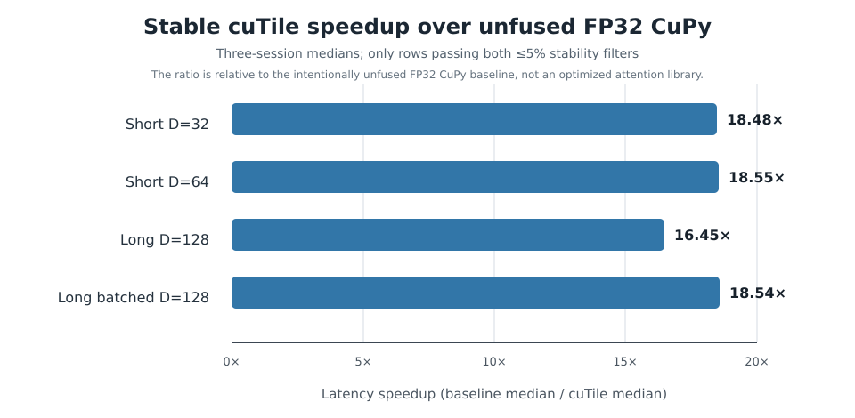
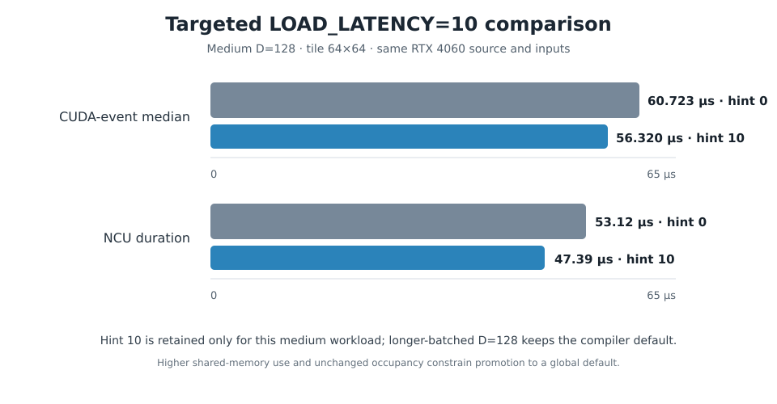

# Fused Causal Self-Attention with NVIDIA cuTile

**IIT Madras GPU Programming Course Project**  
**Submission report — 5 November 2026**  
**Implementation:** Python, NVIDIA cuTile, CuPy, NumPy, CUDA PyTorch  
**Primary validation platform:** NVIDIA GeForce RTX 4060, native Windows x64, SM 8.9  
**Repository:** [xemptynothing/gpu-nvidia](https://github.com/xemptynothing/gpu-nvidia)

## Abstract

This project implements the forward pass of causal scaled dot-product self-attention as a fused NVIDIA cuTile kernel. Query, key and value tensors are processed in tiles. A stable online-softmax recurrence maintains each query row's running maximum, normalization sum and weighted-value accumulator, avoiding global-memory materialization of the full sequence-by-sequence score and probability matrices. The supported contract follows the assignment's independent query-key dimension `D` and value dimension `Dv`, fixed tile-divisibility rule, and batch/head/sequence bounds.

The current implementation passed a genuine cuTile launch and 57 native RTX 4060 GPU test executions. A separate numerical matrix passed all 29 legal workload/tile combinations with zero mixed-tolerance violations and maximum absolute output error 0.0009765625. The deterministic NPZ-to-NPY command-line path passed an independent NumPy check. Three order-varied benchmark sessions cover seven workload families and 29 legal tile rows; 13 rows meet the conservative stability filters. For stable long workloads, the fused kernel measured 16.45× and 18.54× the latency-derived speedup over the deliberately unfused FP32 CuPy baseline. These ratios are not claims against an optimized attention library. A CUDA FP32 PyTorch SDPA reference was independently checked against the NumPy oracle on seven distinct workloads (all passed; maximum absolute discrepancy 0.00048828125 after the documented FP16 output cast). A separate PyTorch efficient-SDPA performance experiment records the actual selected backend and checks both implementations against the independent oracle.

## 1. Objective, scope and contract

The assignment asks for a fused causal self-attention forward path, not a general transformer implementation. For query position `i` and key position `j`,

$$
 s_{ij}=\begin{cases}\frac{q_i\cdot k_j}{\sqrt D},&j\le i,\\-\infty,&j>i,\end{cases}
 \qquad p_{ij}=\frac{e^{s_{ij}}}{\sum_{j'}e^{s_{ij'}}},
 \qquad o_i=\sum_j p_{ij}v_j.
$$

Equivalently, `O = softmax(QKᵀ / √D + M)V`, where `M` masks future keys. The mask is applied before softmax so future tokens receive zero probability and cannot affect earlier outputs.

The validated self-attention input layout is `Q:[B,H,N,D]`, `K:[B,H,N,D]`, `V:[B,H,N,Dv]`; output is `[B,H,N,Dv]`. The assignment permits `D` and `Dv` independently in `{32,64,128}`. The implementation enforces `1≤B≤16`, `1≤H≤32`, `1≤N≤8192`, equal self-attention sequence lengths, contiguous FP16 inputs, legal dimensions, and sequence divisibility by both selected tile sizes. Partial edge tiles are not part of this fixed-tile contract. The output is FP16. The kernel accumulates scores, softmax state and value products in FP32.

The project was validated on a native Windows 11 machine with an RTX 4060 (SM89), driver 616.92, Python 3.12.10, NumPy 2.5.4, CuPy 14.2.0, CUDA Tile 1.6.0 and CUDA Toolkit packages 13.4.3. A sampled SM clock was 2700 MHz and the reported power limit was 115 W; power draw and a fixed-clock policy were unavailable, so no locked-clock claim is made. The Linux A100 system (CC 8.0, R550.90.07) was used only for ordinary CUDA C++ control experiments. Its driver is below the documented R580+ cuTile prerequisite, so none of its results are presented as cuTile measurements.

## 2. Kernel design and work decomposition

### 2.1 Tiled ownership

A cuTile program instance owns one query tile for a batch item, attention head and query-block index. It loads `Q[Tq,D]`, then streams `K[Tk,D]` and `V[Tk,Dv]` tiles. For each key/value tile it computes a temporary score tile `[Tq,Tk]`, multiplies scores by `1/√D`, applies the causal mask, updates the online-softmax state, and adds the weighted values to the running numerator. Once all contributing key/value tiles have been visited, the program divides the numerator by the normalizer and stores `O[Tq,Dv]`.

The fused path performs score calculation, scaling, causal masking, softmax and `P×V` in one cuTile kernel launch per output call. It does not write a complete `N×N` score or probability matrix to global memory. The score/probability objects are tile-local. This reduces intermediate storage and global traffic; the mathematical attention work remains quadratic in sequence length.

The legal tile candidates measured where divisible were `32×64`, `64×64`, `64×128`, `128×64` and `128×128`. The general configuration remains `64×64`; `64×128` is a workload-specific option for the longer batched D=128 workload. Query/key tile dimensions are independent; both must divide `N` under the implemented fixed-tile contract.

### 2.2 Stable online softmax

For each query row, the kernel keeps a running maximum `m`, a normalization sum `l`, and an unnormalized weighted-value numerator `u`. Initially, `m=-∞`, `l=0` and `u=0`. For a new score tile `Sₜ`, after replacing causally masked entries with `-∞`, compute its row maximum `mₜ` and the updated maximum `m′=max(m,mₜ)`. Define

$$
 \alpha=e^{m-m'},\qquad P_t=e^{S_t-m'}.
$$

Then update

$$
 \ell'=\alpha\ell+\sum_j P_{t,j},\qquad
 u'=\alpha u+P_tV_t.
$$

Set `m←m′`, `l←l′`, and `u←u′`. After the final contributing tile, write `o=u/l`. The old numerator and denominator are rescaled to the new maximum before combining the current tile, keeping exponentials numerically stable without retaining all prior scores. A key/value tile lying wholly beyond a query tile's causal boundary is skipped. The implementation also avoids evaluating the undefined `−∞−(−∞)` expression for an entirely future tile.

### 2.3 Precision and launch contract

Q/K/V are stored in FP16; score accumulation, running maximum, normalization, and `P×V` accumulation are FP32. Probability operands are converted to FP16 for the `P×V` multiply while its accumulator remains FP32. Output is FP16. The contract is checked before launch, including independent `D`/`Dv` support and bounds. Invalid or non-divisible configurations fail explicitly rather than silently falling back to a different kernel.

## 3. Correctness and numerical validation

The primary oracle is `src/reference.py`, an independent full-matrix NumPy implementation. It converts the FP16 inputs to FP32, calculates the scaled scores, masks future keys, applies max-shifted softmax, computes `P×V`, and checks finite output. Acceptance uses the fixed mixed rule

$$
 |O_{actual}-O_{reference}|\le 0.02+0.02|O_{reference}|.
$$

The trusted framework reference is `src/torch_reference.py`: it copies the same Q/K/V data to CUDA as FP32 tensors, runs `torch.nn.functional.scaled_dot_product_attention` with `is_causal=True` and zero dropout, then casts the returned output to FP16. The targeted local RTX 4060 framework-reference run [#41511770773](https://github.com/xemptynothing/gpu-nvidia/actions/runs/41511770773) validated this reference on seven distinct workload families against the independent NumPy FP32 oracle: **7/7 passed**, with maximum absolute discrepancy **0.00048828125**. This is the rubric's framework correctness reference, not the speedup denominator. The same run also exercises PyTorch's FP16 efficient-SDPA path and records the operator actually selected by `torch.profiler`.

| Validation gate | Result |
|---|---:|
| Native cuTile smoke / launch | Pass |
| Expanded native GPU tests (`REQUIRE_CUTILE=1`) | 57 passed (includes six additional 64×32 checks across the seven divisible workload lengths) |
| Independent numerical matrix | 29/29 passed |
| Mixed-tolerance violations | 0 |
| Maximum absolute output error | 0.0009765625 |
| Deterministic NPZ → CLI → NPY oracle check | Pass |
| Independent D/Dv and B/H/N contract | Pass |
| CUDA FP32 PyTorch SDPA reference vs NumPy | 7/7 workloads passed; max absolute discrepancy 0.00048828125 |
| Selected optional extension tests | 3 passed |
| Hosted CPU/reference CI | 801 passed; 70 skipped |

The 70 hosted skips are not counted as GPU proof: hosted CI does not install the local CUDA/cuTile stack, and some reference configurations are intentionally filtered when fixed tile sizes do not divide the sequence length. The actual-cuTile test count above comes from the native Windows RTX 4060 run, not from hosted CI.

The PyTorch efficient-SDPA benchmark uses ten legal configuration/tile combinations and three order-varied sessions (30 paired rows). It checks SDPA versus NumPy, cuTile versus NumPy, and cuTile versus SDPA before accepting timings; all 30 checks passed. The profiler-observed backend was `aten::_efficient_attention_forward`. This is PyTorch efficient SDPA, not FlashAttention. This 10-configuration comparison is supplementary; the formal speedup table below continues to use the deliberately unfused FP32 CuPy baseline.

## 4. Performance methodology and results

The benchmark matrix contains seven representative workload families, all three required head dimensions across the tested set, and 29 legal workload/tile pairs. Each session used ten warm-ups, 30 CUDA-event timing samples per configuration, and five kernel launches per sample. Tile order was rotated between the three sessions. Inputs remained resident on the GPU. The unfused FP32 CuPy baseline was bracketed before and after each tile sweep to expose drift. The reported fused latency is a per-launch median; speedup is the unfused CuPy median divided by the cuTile median.

A result is called stable for headline purposes only when both the three-session fused-median range and maximum baseline-bracket drift are at most 5%. Thirteen of the 29 rows pass both filters; the other sixteen are retained in the raw JSON/CSV but are not used as precise headline claims. This is important for short and medium workloads, where WDDM scheduling and baseline drift can dominate small differences between tiles.

| Representative workload | Tile | cuTile median | Unfused FP32 CuPy | Speedup |
|---|---:|---:|---:|---:|
| Short D=32 | 64×64 | 0.015770 ms | 0.292509 ms | 18.48× |
| Short D=64 | 32×64 | 0.015850 ms | 0.272538 ms | 18.55× |
| Long D=128, N=1024 | 64×64 | 0.266445 ms | 4.383078 ms | 16.45× |
| Longer batched D=128, N=2048 | 64×128 | 0.922214 ms | 17.109811 ms | 18.54× |

These measurements demonstrate the value of fusing the operations and avoiding full intermediate score/probability matrices relative to the project's deliberately unfused FP32 CuPy implementation. They do **not** establish an equivalent speedup over FlashAttention or another optimized vendor attention kernel. The benchmark records output-byte throughput; it must not be relabelled as total memory bandwidth.



### 4.1 Framework attention comparison

The separate RTX 4060 framework comparison [#41511770773](https://github.com/xemptynothing/gpu-nvidia/actions/runs/41511770773) used PyTorch 2.14.0+cu130 and CUDA build 13.0. The actual efficient-SDPA operator was identified through `torch.profiler` as `aten::_efficient_attention_forward`. Ten configurations were measured over three sessions, with ten warm-ups, 30 CUDA-event samples and five launches per sample. Six configurations had at most 5% session spread for both backends; noisier rows remain flagged. The per-configuration median cuTile advantage ranged from 1.07× to 2.16× in this run. These same-machine observations are supplementary and are not used to replace the unfused-CuPy performance denominator.

Representative medians from the published run were: medium D=128 / 64×64, PyTorch efficient SDPA 0.072790 ms vs cuTile 0.060269 ms (1.21×); long D=128 / 64×128, 0.291786 ms vs 0.272643 ms (1.07×); longer batched D=128 / 64×128, 1.003024 ms vs 0.919251 ms (1.09×); and short D=32 / 64×64, 0.046384 ms vs 0.021555 ms (2.15×). All outputs passed the same mixed-tolerance checks against the NumPy oracle and against each other. Raw JSON/CSV, per-workload FP32 reference accuracy and environment logs are preserved under `results/sdpa-reference/41511770773/` in the [evidence commit](https://github.com/xemptynothing/gpu-nvidia/commit/5e834fbfebe3e451edc14a60d3fc978149bee449).

### 4.2 First-call and JIT-associated time

A separate clean-cache experiment ran each long specialization in a fresh Python process after verifying that the cuTile and CUDA driver cache directories were empty. Context creation, imports and input preparation were excluded. The first-call timer includes compilation, first launch and synchronization; it is therefore JIT-associated wall time, not a compiler-only duration.

| Specialization | First call | Steady median | Steady P90 | Oracle |
|---|---:|---:|---:|---|
| Long D=128 / 64×64 | 2170.951 ms | 0.287027 ms | 0.289371 ms | Pass |
| Longer batched D=128 / 64×128 | 3059.894 ms | 0.988467 ms | 0.994714 ms | Pass |

## 5. Nsight Compute analysis and optimization

The repository retains 27 native RTX 4060 `.ncu-repz` profiles, per-configuration Details/Raw exports, PTX/SASS exports and Markdown analyses. Two configurations are sufficient for the assignment's minimum profiler comparison, but the wider 27-profile set makes the resource and scheduler patterns easier to cross-check. The captures were performed on the RTX 4060 / SM89; A100 CUDA C++ experiments are kept separate.

The current matched medium-D=128 / 64×64 profile compares compiler-default `LOAD_LATENCY=0` against the targeted `LOAD_LATENCY=10` candidate:

| Metric | Hint 0 | Hint 10 |
|---|---:|---:|
| Three-session CUDA-event median | 0.057344 ms | 0.050074 ms |
| Candidate median improvement | — | 12.68% |
| Candidate session range | 8.04% | 2.25% |
| Matched NCU kernel duration | 52.80 µs | 47.49 µs |
| DRAM throughput vs device peak | 22.94% | 25.74% |
| SM compute throughput vs device peak | 18.84% | 21.18% |
| Registers / thread | 231 | 238 |
| Static shared memory / CTA | 65.54 KiB | 98.30 KiB |
| Achieved occupancy | 8.39% | 8.32% |

The expanded three-session hint sweep accepted hint 10 for medium D=128 / 64×64: the median improved by 12.68%, while the candidate range was 2.25%, clearing the noise-aware 5.14% threshold. The matched NCU duration fell from 52.80 to 47.49 µs, with modest increases in compute/DRAM throughput. Static shared-memory usage rose from 65.54 to 98.30 KiB and achieved occupancy changed from 8.39% to 8.32%. Therefore hint 10 is an opt-in specialization for this workload only; the global default remains hint 0. The longer-batched D=128 workload rejects nonzero latency hints; its separate Week 3 tile-width choice is discussed below.



Across the representative profiles, shared-memory footprint and register pressure constrain CTA residency. The medium profile has about four active warps per SM and roughly one resident CTA; the scheduler reports many cycles with no eligible warp. Neither DRAM nor SM throughput approaches device peak. This points to latency-hiding and parallelism pressure rather than a saturated DRAM bandwidth limit. The next hypothesis is to reduce per-CTA shared-memory footprint or increase the eligible warp pool, then re-run correctness, order-varied timings and matched NCU captures. Nsight rule-engine “estimated speedups” are heuristics, not measured gains; blank dependency/source-marker panes and generated stub code do not establish that dependencies or source mappings are absent.


### 5.1 Week 3 second profiler-guided improvement: longer-batched tile choice

The Week 3 rubric requires a second, distinct profiler-guided optimization loop. This is separate from the Week 2 LOAD_LATENCY=10 hint sweep above. On the expanded current source, the longer-batched D=128 workload (B=2, H=8, N=2048, D=Dv=128) was compared using query tile 64 and key tiles 64 versus 128. Both configurations passed the native cuTile correctness matrix. The full three-session benchmark sweep provides the stable performance comparison:

| Tile | Fused median | Three-session range | Max baseline-bracket drift | Speedup vs unfused FP32 CuPy |
|---|---:|---:|---:|---:|
| 64×64 | 0.936346 ms | 0.525% | 0.055% | 18.29× |
| 64×128 | 0.921395 ms | 0.456% | 0.055% | 18.60× |

The 64×128 choice reduces median latency by **1.60%** relative to 64×64. Both options meet the predeclared ≤5% session-spread and baseline-drift criteria. The benchmark used three sessions, ten warmups, 30 CUDA-event samples and five launches per sample; the baseline remains the deliberately unfused FP32 CuPy implementation.

A matched four-report Nsight Compute comparison on the same RTX 4060, source and longer-batched workload supports the timing direction but exposes a resource trade-off:

| NCU metric | 64×64 | 64×128 |
|---|---:|---:|
| Kernel duration | 997.73 µs | 990.98 µs |
| Memory throughput | 19.65% | 20.21% |
| DRAM throughput | 11.67% | 11.81% |
| SM compute throughput | 29.03% | 30.23% |
| Registers per thread | 227 | 255 |
| Static shared memory per CTA | 65.54 KiB | 81.92 KiB |
| Achieved occupancy | 8.33% | 8.33% |
| Eligible warps per scheduler | 0.16 | 0.15 |
| No-eligible scheduler cycles | 84.48% | 85.24% |
| Warp cycles per issued instruction | 6.44 | 6.80 |

The instrumented duration is 0.68% lower and memory/DRAM throughput rise slightly with 64×128, but the larger tile uses 28 more registers per thread and 16.38 KiB more static shared memory per CTA. Occupancy does not improve, while scheduler eligibility is marginally worse. This is therefore accepted only as a **workload-specific tile selection** for the longer-batched D=128 case, not as a global kernel improvement. The global tile default remains 64×64.

Two isolated paired retries are retained as negative/variance evidence and are not used as headline claims: run [#42073544473](https://github.com/xemptynothing/gpu-nvidia/actions/runs/42073544473) had a 64×64 session range just over 5%; run [#42073654984](https://github.com/xemptynothing/gpu-nvidia/actions/runs/42073654984) exceeded the 5% spread gate for both choices. The accepted comparison instead uses the stable 29-row/three-session matrix and the matched NCU pair from [run #42076178947](https://github.com/xemptynothing/gpu-nvidia/actions/runs/42076178947), [artifact #13440087603](https://github.com/xemptynothing/gpu-nvidia/actions/runs/42076178947/artifacts/13440087603). A fuller counter table and reproduction references are recorded in [the Week 3 NCU analysis](ncu/rtx4060/WEEK3_TILE_CHOICE_2026-11-05.md).

The residual bottleneck remains low CTA residency and a very small eligible-warp pool, not saturated DRAM bandwidth: DRAM throughput is only about 12% of device peak, and occupancy is unchanged at 8.33%. Further tuning should target per-CTA shared-memory/register footprint and latency hiding, then re-run correctness, timing and matched NCU measurements.

### 5.2 GUI and disassembly evidence boundary

The repository contains 972 original NCU GUI screenshots (864 primary views plus 108 PTX supplements), all 1936×1048. All 27 profile contact sheets were checked for view coverage, representative full-resolution Summary/Details/Source views were inspected, and the exports were reviewed. A corrected horizontal movement/restore audit covers all 27 profiles, both SASS and PTX modes, and four panes per mode: 216 pane checks passed with zero failures; 486 before/scrolled/restored images are preserved in 27 profile archives. The export inventory identifies tensor-core `HMMA.16816.F32` in SASS and FMA, exponent, control-flow and synchronization operations in PTX.

This evidence supports the profiler discussion but does not claim a literal manual transcription of every visible value and instruction in every one of the 972 screenshots. That separate, owner-requested image-by-image task remains open. It is not an objective stated in the six-page course brief and is not represented as a course-project blocker in this report.

## 6. Optimization history, negative results and limitations

The fused implementation combines causal pruning of key/value tiles that cannot contribute and mixed-precision `P×V` operands with FP32 accumulation. Two separate profiler-guided choices are supported on the RTX 4060: (1) `LOAD_LATENCY=10` for medium D=128 / 64×64, with the compiler default retained for other workloads; and (2) a 64×128 tile for the longer-batched D=128 workload, where a stable three-session comparison improved median latency by 1.60% and matched NCU duration by 0.68%. The second tile increases shared-memory/register use without improving occupancy, so 64×64 remains the global tile default. The isolated paired retry runs exceeded the stability gate and are retained as negative/variance evidence, not performance claims.

The short/medium timing matrix includes noisy rows. They remain available in raw evidence, but claims based on those rows are not promoted. Low DRAM throughput is not, by itself, proof of a memory-bound kernel. Nsight's local-speedup estimates are diagnostic rules, not benchmark results. The framework timing comparison identifies efficient SDPA, not FlashAttention. The CuPy baseline is intentionally unfused. No claim is made that the current kernel beats every vendor implementation or generalizes unchanged to other GPUs/drivers.

The core is forward-only causal self-attention under the fixed-tile contract. Backward propagation, arbitrary non-divisible edge tiles, BF16/FP8, packed variable-length sequences, GQA/MQA, autotuning and architecture-specific asynchronous pipelines are optional extensions in the assignment, not required acceptance criteria. Selected optional correctness tests passed, but the optional extensions are not conflated with the core implementation or used to inflate core coverage. The Linux A100 measurements are ordinary CUDA C++ controls, not cuTile results.

## 7. Reproduction, deliverables and contribution record

The repository includes the cuTile implementation and launch contract, NumPy and tiled references, unfused CuPy baseline, NPZ/NPY CLI, CPU/GPU tests, benchmark and profiler scripts, raw JSON/CSV results, current-run logs, 27 profile analyses, horizontal-pane proof archives, setup instructions and this report. The principal reproducibility commands on the validated Windows machine are:

```powershell
$py = ".\.venv-cutile-windows\Scripts\python.exe"
& $py scripts\cutile_smoke.py
$env:REQUIRE_CUTILE = "1"
& $py -m pytest -v -ra tests\test_gpu_correctness.py tests\test_gpu_edge_cases.py
& $py scripts\mentor_numerical_matrix.py --output .tmp\validation-matrix.json
& $py run_attention.py `
  --input INPUT.npz --output OUTPUT.npy `
  --backend cutile --tile-q 64 --tile-k 64
& $py scripts\verify_cli_output.py --input INPUT.npz --output OUTPUT.npy
```

The checked-in input generator supplies deterministic FP16 test cases; the benchmark scripts document warm-up, event sample and session-order settings. The expanded native cuTile evidence is [workflow #42075683189](https://github.com/xemptynothing/gpu-nvidia/actions/runs/42075683189); the FP32 framework reference plus efficient-SDPA comparison is [workflow #41511770773](https://github.com/xemptynothing/gpu-nvidia/actions/runs/41511770773), with published results in [commit 5e834fb](https://github.com/xemptynothing/gpu-nvidia/commit/5e834fbfebe3e451edc14a60d3fc978149bee449). The latest CPU/reference CI is [workflow #42080908745](https://github.com/xemptynothing/gpu-nvidia/actions/runs/42080908745) (801 passed, 70 expected skips). The [assignment audit](ASSIGNMENT_BRIEF_AUDIT.md) maps each original PDF requirement to code and evidence.

**Repository contribution record:** the latest 100 Git commits inspected for this report show `xemptynothing` as the human author identity for the project changes; `github-actions[bot]` commits publish automated run evidence. On repository evidence, the work is attributed to `xemptynothing`: kernel and contract implementation, references, tests, benchmark/profiling workflows, result analysis and documentation. Git history cannot establish work or assistance performed outside the repository, so no percentage allocation or unrecorded contributor is invented. The project owner should amend this statement if there were additional off-repository contributors.

## 8. Assignment milestone disposition

**Week 1 — complete:** fused kernel, contract, references and expanded native RTX 4060 correctness (57 tests; 29/29 numerical matrix). **Week 2 — complete:** baseline, tile matrix and the first profiler-guided hint optimization. **Week 3 — complete:** a second, distinct tile-choice optimization for longer-batched D=128 is supported by stable timing and matched NCU profiles; negative/variance runs and the remaining resource bottleneck are documented. **Week 4 — complete for the course brief:** reproducibility, current measurements, analysis and this 5–8 page report are present. The separate 972-image literal transcription remains an owner-requested extension, not a missing PDF objective.